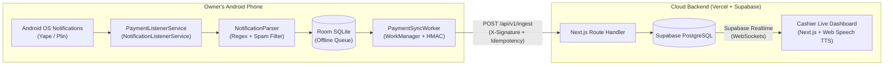

# PagoPulse (`pago-pulse`)

> **Real-time mobile payment verification and daily cash reconciliation system for Peruvian merchants using Yape and Plin.**

PagoPulse eliminates fake payment screenshot fraud at the point of sale without requiring merchants to share bank credentials with cashiers. A lightweight native Android agent on the business owner's phone captures incoming **Yape** and **Plin** payment notifications, filters out promotional spam, signs the payload with `HMAC-SHA256`, and streams verified payments in `< 1s` to a read-only Cashier Web Dashboard with automatic Spanish voice announcements (`Web Speech API`).

---

## 1. System Architecture



### Core Engineering Principles
1. **Native Kotlin Android Agent:** Uses a persistent `ForegroundService` (`NotificationListenerService`), a local `Room` SQLite queue (`payment_queue`), and expedited `WorkManager` jobs with exponential backoff to survive aggressive OEM battery savers (Xiaomi HyperOS/MIUI, Samsung OneUI) and transient 4G/Wi-Fi drops.
2. **Deterministic Idempotency:** Every captured payment computes a deterministic 64-character SHA-256 `idempotencyKey` before leaving the device. Duplicate notification broadcasts or network retries are deduplicated both at the local SQLite index (`OnConflictStrategy.IGNORE`) and in PostgreSQL (`UNIQUE` constraint `23505` returning `200 OK`).
3. **Zero-Trust QR Pairing & HMAC-SHA256 Signing:** The business owner generates a pairing QR code on `/devices` containing `{ organizationId, deviceId, webhookSecret, apiBaseUrl }`. The Android agent stores the secret in `EncryptedSharedPreferences` and signs every request body with `HMAC_SHA256(webhook_secret, "${timestamp}.${rawBody}")`.

---

## 2. Repository Structure

```text
pago-pulse/
├── .github/workflows/
│   ├── web-ci.yml                  # TypeScript, Vitest, and Next.js build pipeline
│   └── android-release.yml         # Gradle JVM unit tests and APK artifact build
├── android-agent/                  # Native Kotlin Android Project (minSdk 26, targetSdk 35)
│   └── app/src/
│       ├── main/java/com/pagopulse/agent/
│       │   ├── core/               # CryptoUtils, DevicePrefs, BatteryHelper
│       │   ├── domain/             # Pure Kotlin NotificationParser, ParsedPayment, WalletType
│       │   ├── data/local/         # Room AppDatabase, PaymentQueueEntity, PaymentQueueDao
│       │   ├── data/remote/        # IngestApiService, PaymentSyncWorker
│       │   ├── service/            # PaymentListenerService, HeartbeatWorker
│       │   └── ui/                 # Jetpack Compose QrPairingScreen, AgentStatusScreen
│       └── test/java/com/pagopulse/agent/domain/
│           └── NotificationParserTest.kt  # 26 JVM unit tests for Yape/Plin & spam blocklist
├── web-dashboard/                  # Next.js 15 (App Router, TypeScript, Tailwind CSS)
│   ├── scripts/
│   │   └── simulate-payment.ts     # CLI simulator for signed Yape/Plin webhooks & heartbeats
│   ├── src/
│   │   ├── app/
│   │   │   ├── (auth)/login/       # Role-based access (OWNER vs CASHIER)
│   │   │   ├── (dashboard)/live/   # Real-time cashier feed + Web Audio chime + Spanish TTS
│   │   │   ├── (dashboard)/history/# Daily reconciliation filters, wallet subtotals & CSV export
│   │   │   ├── (dashboard)/devices/# QR generator for Android pairing & battery health monitor
│   │   │   └── api/v1/             # /ingest, /heartbeat, /payments, /devices route handlers
│   │   ├── components/             # LivePaymentFeed, PaymentCard, ClaimPaymentDialog, PairingQrModal
│   │   └── lib/                    # HMAC verifier, Zod schemas, Spanish TTS announcer, CSV exporter
│   └── tests/
│       ├── unit/                   # Vitest unit & integration test suites
│       └── e2e/                    # Playwright end-to-end cashier verification test
└── supabase/
    ├── config.toml
    ├── migrations/20261021000001_init_schema.sql
    └── seed.sql
```

---

## 3. Security & Webhook Contract (`POST /api/v1/ingest`)

### Request Headers
| Header | Description |
| :--- | :--- |
| `X-Device-Id` | UUID of the registered `listener_devices` record |
| `X-Timestamp` | Current Unix epoch timestamp in seconds (validated within a 300s replay window) |
| `X-Signature` | Lowercase hex of `HMAC_SHA256(webhook_secret, "${timestamp}.${rawBody}")` |

### Request Body
```json
{
  "idempotencyKey": "e3b0c44298fc1c149afbf4c8996fb92427ae41e4649b934ca495991b7852b855",
  "wallet": "YAPE",
  "amount": 45.50,
  "senderName": "Carlos Mendoza",
  "securityCode": "842",
  "rawNotification": "Confirmación de Pago. Carlos Mendoza te envió un pago por S/ 45.50. El código de seguridad es: 842",
  "notifiedAt": "2026-10-21T22:30:00Z"
}
```

### Response Status Codes
- `201 Created`: New payment verified, persisted, and broadcasted to `/live`.
- `200 OK`: Duplicate `idempotencyKey` already processed (idempotent retry; Android worker marks item as `SYNCED`).
- `400 Bad Request`: Malformed JSON or failed Zod schema validation.
- `401 Unauthorized`: Invalid HMAC signature, expired timestamp, or inactive device.

---

## 4. Local Setup & Testing Instructions

> **Zero-Docker Standalone Mode Included:** When `SUPABASE_SERVICE_ROLE_KEY` is not set, `web-dashboard` automatically uses an embedded local JSON store pre-seeded with a demo organization (`Bodega Don Pepe`) and a paired listener device (`00000000-0000-4000-8000-000000000001`) so you can test the entire webhook -> live dashboard -> audio TTS -> claim flow immediately.

### 4.1 Install Dependencies & Run Unit Tests
```bash
npm --prefix web-dashboard install
npm --prefix web-dashboard test
```

### 4.2 Start the Web Dashboard
```bash
npm --prefix web-dashboard run dev
```
Open `http://localhost:3000/live` in your browser and click **"Altavoz TTS: Activo"** or **"Probar voz"** once to unlock browser audio permissions.

### 4.3 Simulate Real-Time Yape & Plin Payments from CLI
In a second terminal, send signed webhooks to your running dashboard:

```bash
# Send a random Yape payment
npm --prefix web-dashboard run simulate:payment

# Send a specific Yape payment with 3-digit security code
npm --prefix web-dashboard run simulate:payment -- --wallet=YAPE --amount=45.50 --sender="Carlos Mendoza" --code=842

# Send a Plin payment
npm --prefix web-dashboard run simulate:payment -- --wallet=PLIN --amount=120.00 --sender="Lucía Fernández"

# Test idempotency (sends the exact same payment twice -> 201 Created then 200 OK duplicate)
npm --prefix web-dashboard run simulate:payment -- --duplicate

# Send a device battery heartbeat ping
npm --prefix web-dashboard run simulate:payment -- --heartbeat --battery=88
```

### 4.4 Android Agent Unit Tests & APK Build
```bash
cd android-agent
./gradlew testDebugUnitTest
./gradlew assembleDebug
```

